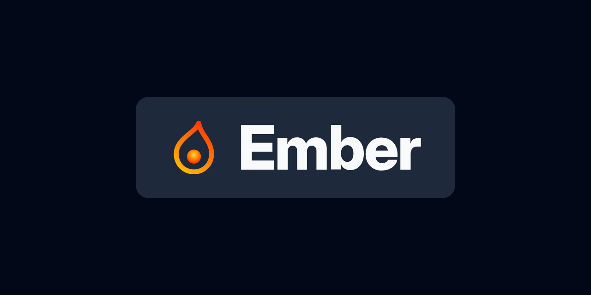

<div align="center">
  

### Flare on your phone

[](https://github.com/FlintSH/Ember/releases)
[](https://github.com/FlintSH/Ember/actions/workflows/ci.yml)
[](docs/getting-started.md#requirements)
[](https://discord.gg/mwVAjKwPus)

</div>

Ember is the Android companion for [Flare](https://github.com/FlintSH/Flare), the self-hosted file sharing platform. Share a file from any app and get a Flare link back, turn selected text into a paste, shorten links under your own domain, and keep folders like your camera roll and screenshots synced to your Flare automatically.

Ember talks only to the Flare server you connect it to. There are no accounts, analytics, or third-party services.

## ✨ Features

- 📤 **Upload from anywhere.** Choose **Upload to Flare** in any app's share menu. Ember uploads in the background, copies the link, and shows a notification with Copy and Share.
- 📝 **Paste to Flare.** Select text in any app and choose **Paste to Flare**. In a text field, the link replaces your selection. A Quick Settings tile turns whatever is on your clipboard into a paste or short link.
- 🔗 **Short links.** Share a link to Ember, or use **Shorten link**, to get a short link under your Flare domain.
- 🔁 **Folder sync.** Pick photo albums the way Google Photos lists them, such as Camera and Screenshots, or any folder through the system picker. New files upload on their own, each one once. Screenshots can copy their link the moment they upload, like a desktop screenshot tool.
- 🗂️ **Your library.** Browse and search your Flare files, copy links, and see everything uploaded from this phone.
- ⚙️ **Your defaults.** Choose visibility, expiration, folder, and upload profile for every upload, per synced folder, or per share.
- 🔒 **Careful with your token.** Ember keeps it encrypted with the Android Keystore, never backs it up, and only needs the scopes you choose.
- 🌓 **Looks like Flare.** Flare's palette, Inter, and Lucide icons, in dark (the default) or light.

## 📖 Documentation

- **Start here:** [Install and connect](docs/getting-started.md)
- **Use Ember:** [Share, paste, and shorten](docs/sharing.md) · [Folder sync](docs/sync.md) · [Library and links](docs/library.md) · [Settings](docs/settings.md)
- **Trust and fixes:** [Security and privacy](docs/security.md) · [Troubleshooting](docs/troubleshooting.md)
- **Work on Ember:** [Architecture](docs/architecture.md) · [Testing](docs/testing.md) · [Releasing](docs/releasing.md) · [Contributing](CONTRIBUTING.md)

## 🚀 Quick start

1. Download `Ember-x.y.z.apk` from the [latest release](https://github.com/FlintSH/Ember/releases/latest) and open it on your phone.
2. In Flare, open **Profile → Integrations**, choose **New token**, and select **Upload files**. Add **Read files**, **Read short links**, and **Manage short links** to use the library and short links too. Copy the `flr_…` secret.
3. Open Ember, choose **Connect to Flare**, enter your Flare address, and paste the token.

Ember works with Flare 3.0 and later. The [getting started guide](docs/getting-started.md) covers local network servers, plain HTTP, private certificates, and the older account upload token.

### Verify a download

Every release lists SHA-256 checksums in `SHA256SUMS`. Release APKs are signed with this certificate:

```text
SHA-256: 99:0D:09:8E:FE:E3:7E:AB:6D:28:6D:75:2D:F8:CD:17:F1:46:EF:9E:14:E5:00:1A:F3:C4:E1:F1:00:81:86:9B
```

Check it with `apksigner verify --print-certs Ember-x.y.z.apk`. Android also refuses to update Ember with an APK signed by a different key.

### Release channels

- **Stable** releases (`vX.Y.Z`) are tagged when the version changes on `main`.
- **Rolling** builds every other commit to `main` as **Ember Rolling**, a separate app that installs next to stable. Use it to try changes early.

Both are published only after the same lint, unit, screenshot, live Flare, and emulator tests pass. Apps such as [Obtainium](https://github.com/ImranR98/Obtainium) can keep either channel up to date from GitHub.

## 💬 Support

Questions, ideas, or problems: open an [issue](https://github.com/FlintSH/Ember/issues) or ask in the [Flare Discord](https://discord.gg/mwVAjKwPus).

## 📜 License

Ember is licensed under the [MIT License](LICENSE). It bundles the Inter typeface and Lucide icons; see [third-party notices](THIRD_PARTY_NOTICES.md).
